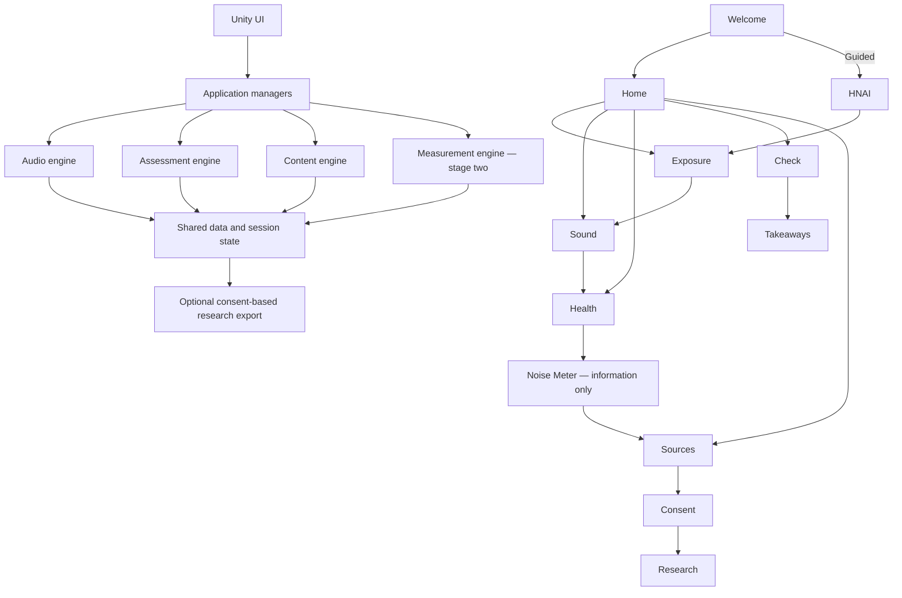

# Hearing Notion — Functional Prototype Architecture
Version 0.1 · World Hearing Forum · Unity/C#

Explore sound. Understand exposure. Protect your hearing.

## Product and scope
Build a functional, offline, desktop-first demonstration for Windows, with macOS as a subsequent build target, in English and Spanish. Participants should be able to complete a guided experience in approximately 5–8 minutes or explore modules independently. Audience: young adults, students, educators, hearing-health professionals, and the public. Desktop-first and bilingual support follow the supplied preference; mobile remains a later adaptation. Forum context does not imply institutional endorsement.

Core: welcome/navigation, exposure explorer, auditory simulations, hearing-health education, and awareness assessment. Second stage: estimated sound-level meter. Future: music-perception laboratory. Do not delay the core experience for microphone calibration. No account or cloud backend is needed.

## Application structure
Use one app-owned scene, `Assets/_HearingNotion/Scenes/Main.unity`, with persistent managers and modular Canvas panel roots. Main.unity now contains a template-derived home grid and introductory destination panels. It is the clickable navigation prototype; module interactions remain pending. Keep managers outside all screen roots. Use TextMesh Pro, uGUI, CanvasScaler, keyboard focus, and pointer interactions. Begin at a 1920×1080 reference resolution with responsive anchors; verify smaller desktop windows and long Spanish text. Actual device and headphone output testing remains required.

The public path does not require research consent or a baseline research questionnaire. Sound demonstrations are optional and can be skipped. Research consent gates only research administration and research export. The current guided journey starts with the full Spanish HNAI, then Exposure Explorer, Sound Experience, Hearing Health recommendations, informational Noise Meter and Research & Resources. Brief Spanish introduction modals appear once per stage per run. Completing HNAI enables guided continuation. Full HNAI may extend the original 5–8-minute target; duration must be measured rather than assumed. See GuidedExperience.md.

## Screen by screen design
| Screen | Content and interaction | Navigation and Unity components |
| --- | --- | --- |
| Welcome | Purpose, EN/ES selection, listening instructions, Start guided, Explore freely. Record acknowledgement only before audio playback. | AppManager, NavigationManager, SessionManager; TMP labels, language buttons, safety panel. |
| Home | Five core module cards, Research & Sources, session reset. Noise Meter marked stage two; Music Lab marked future, neither launches an unfinished feature. | Menu template cards; persistent Home/Back/Settings controls. |
| Exposure Explorer | Environmental/recreational/occupational category filters; selectable activity cards; detail panel with description, research prevalence and study context, linked audio, sourced acoustic ranges where available, prevention. | ExposureManager; ScrollRect, GridLayoutGroup, card prefab, detail panel. Guided Next works with no selections. |
| Sound Experience | Tabs for protection, hearing loss and tinnitus; approved example selection, original/processed A/B where applicable, play/pause, stop, repeat, explanation, captions, comfortable-volume prompt, optional skip. | AudioSimulationManager and AudioSafetyManager; persistent AudioSources, audio player prefab, Slider, Buttons. Leaving screen, reset, loss of focus, or pause stops playback. |
| Hearing Health | Five topic cards: auditory damage, tinnitus, concentration/listening effort, sleep/stress/cardiovascular health, protection/safer listening. Each uses What happens / Why it matters / What can I do. | ContentManager; article panel, ScrollRect, read-more and Sources links, accessible text. |
| Awareness Check | Short app-authored educational questions, answer controls, immediate explanations, review and finish. Clearly label as learning feedback, separate from research scales. | AssessmentManager in public mode; Quiz layout adapted without competitive scoring; progress label, optional skip. |
| Personalized Takeaways | Selected activities, topics visited, knowledge feedback, relevant protective habits, choose a habit, optional retry. No diagnostic risk category or invented participant outcomes. | SessionManager and content lookup; Result/Tracker layout, action buttons; Home, Reset, optional reassessment. |
| Research & Sources | Study citations, methods, aggregate figures labeled by instrument/sample, limitations, separate research-mode entry. | ContentManager; source cards and detail panels; no synthesized individual data from figures. |
| Research Consent | Study-specific information, version, voluntary participation and export choices; accept/decline/withdraw. Unconfigured study cannot administer or export. | SessionManager plus future protocol controller; dialog/scroll panel. Decline returns to Sources, preserving public access. |
| Research Assessment | Full approved HNAI or YANS selected separately; exact language/version/scale, phase, save response in session, completion/missing-answer rules; scoring only from approved protocol. | AssessmentManager; JSON definition loader, question panel, response controls. Separate baseline/follow-up attempts and instrument IDs. |
| Settings | Language, captions/text preferences, audio mute, restart, privacy explanation. Reset confirmation stops audio and clears all visitor state. | ContentManager, AudioSafetyManager, SessionManager; Settings template, Slider Toggle, DialogBoxYesNo. |
| Noise Meter — stage two | Microphone permission, device selection, start/stop, estimated level and calibration status. Never equate uncalibrated digital RMS/dBFS with dBA. | NoiseMeterManager with independent acquisition/analysis/calibration adapters; disabled core navigation. |
| Music Lab — future | Reserved for hearing-loss-aware music processing research. | Separate future DSP module; disabled core navigation. |

## Manager responsibilities and interfaces
| Component | Responsibility and contract | Status |
| --- | --- | --- |
| AppManager | Initialize managers and a fresh session; report missing bindings. | Foundation implemented |
| NavigationManager | Registered panels, Back/Home, free exploration, guided Next/Skip, research route guard; ScreenChanged event. | Foundation implemented |
| ContentManager | Versioned activity/topic/audio catalogs, localized strings, references and fallbacks. | Designed; content data assets defined |
| ExposureManager | Select/deselect activity IDs; recommend associated examples without estimating individual risk. | Designed |
| AudioSimulationManager | One playback owner; play/pause/stop/repeat, aligned A/B timeline; curated rendered assets first, optional runtime DSP later. | Designed |
| AudioSafetyManager | Reviewed gain ceiling, fades, limiter strategy, safe transitions and stop on navigation/focus/reset. Reject unreviewed clips. Device acoustic output cannot be guaranteed by software gain. | Designed |
| AssessmentManager | Separate public feedback from research administration; validate JSON IDs/scales, phase, completion, scoring and responses. | Definition validation implemented; controller pending |
| NoiseMeterManager | Microphone acquisition, RMS, weighting, calibration and display context. | Deferred |
| SessionManager | In-memory visitor state, fresh reset, versioned research consent and withdrawal. SessionReset event. | Foundation implemented |
| DataExportManager | Explicit consent-based, user-initiated export with schema/protocol/instrument versions; no automatic export. | Designed; no export implemented |

Events decouple views and playback from navigation and reset. SessionReset subscribers must stop audio, clear UI answers and selections, and discard pending export data. They must unsubscribe when destroyed. SessionManager itself clears session data; visual/audio subscriber wiring awaits scene construction. The current consent setter is infrastructure, not an approved study consent workflow.

## Shared data contracts
ActivityDefinition: stable ID, category, localized description, optional research prevalence with source/group/sample context, soundscape ID, optional reference levels with units/metric/duration/measurement context/source, and prevention text. Prevalence describes reported activities, not measured exposure.

AudioExampleDefinition: stable ID, simulation type, original and processed clips, localized explanation/transcript, source/license record, content review state, approved gain. Protection compares original versus illustrative attenuation. Hearing-loss examples disclose simplifications. Tinnitus permits tonal/narrowband/broadband examples without automatic playback. The pilot's filters, modeled threshold shifts and approximately 6 kHz examples are research provenance, not automatically approved public playback settings. Review original research audio and distribution rights before import; no files have been supplied or imported here.

EducationalTopicDefinition: stable ID, localized title, What happens / Why it matters / What can I do, linked references, version/review state. Do not publish unreviewed numeric exposure guidance.

Questionnaire JSON: schemaVersion, instrumentId, instrumentVersion, language, mode, protocolId, administrationPhase, instructions, ordered items with stable IDs and instrument-specific domain IDs, response choices, scoring specification, missing-response rules, approval state. Public questions may have correct answers and feedback; HNAI/YANS responses must not use correctness feedback. Distinct instrument identifiers prevent mixing scales. The current ScriptableObject definition validates IDs/choices as a foundation; the JSON loader and scoring engine are pending.

HNAI source: refined 22-item model, Perceived Knowledge 9, Perceived Exposure/Impact 5, Perceived Awareness 8. Preserve exact source wording. Response labels, reverse coding, timing and scoring require confirmation; preliminary validation and weaker Exposure/Impact reliability must remain visible in research context. The pilot's earlier 18-item instrument is a separate version. YANS has a separate four-factor structure; supplied figures do not contain its complete items or scoring protocol. Attitude changes do not establish changed protective behavior.

Session: language, journey mode, selected activity IDs, completed topics, public feedback/research response records, chosen habit, consent version and timestamp. No personally identifiable information or disk persistence by default. Research additions require a protocol-specific pseudonymous identifier, consent governance and retention/deletion rules. Anonymous usage metrics remain optional, local and disabled until defined; no analytics SDK is included.

Export: explicit destination/action; schema version, protocol ID, consent record, instrument version, phase and timestamped responses. Exclude identifiers and public visitor data unless explicitly covered. Revocation clears in-memory research responses. Files already exported would require a documented withdrawal process; export is not implemented yet.

## Project organization and template reuse
App code and future scene/assets live under `Assets/_HearingNotion`: Scenes, Scripts/Core, Navigation, Exposure, Audio, Assessment, NoiseMeter, Data, Content; Prefabs/UI, ActivityCards, AudioPlayers; ScriptableObjects/Activities, AudioExamples, EducationalTopics; Audio/Soundscapes, HearingProtection, HearingLoss, Tinnitus; UI/Sprites, Fonts, Icons.

Unity's player packaging requires StreamingAssets at `Assets/StreamingAssets`, so questionnaire/localization JSON belongs under `Assets/StreamingAssets/HearingNotion/Questionnaires` and `Localization`, rather than the nested StreamingAssets path in the proposed outline. A platform-aware loader is needed for later WebGL/Android builds. Language content must be keyed EN/ES, with explicit fallback, and switching must preserve responses by stable IDs.

Retain the vendor package as reference. Reuse only selected layouts: Menu for Home; Category/Item List for Exposure; Music Playlist/Mixer for Sound; Blog News/News for Health; Quiz for Awareness; Result/Tracker for Takeaways; Settings for Settings; DialogBoxYesNo, Slider, Slider Toggle as needed. Copy chosen layouts into app-owned prefabs when composing Main; vendor scenes stay out of Build Settings. No login/account screens are needed. Mobile portrait layouts need deliberate desktop adaptation, not a blanket scene import.

## Delivery roadmap and verification
1. UI/navigation: compose Main scene, bilingual module cards, guided/free flow, back/home/reset, keyboard and pointer controls. Deliver clickable application.
2. Audio: review licenses/levels, import clips, A/B alignment, normalization/limiting/fades, explicit play, captions/skip, stop on interruption. Deliver functional auditory experience.
3. Content/assessments: authored activities, five topics, public knowledge check, instrument loader, approved research protocol and consent/export. Deliver complete guided experience.
4. Meter: independent microphone/calibration milestone; estimated output labeled with measurement limitations.
5. Demonstration readiness: device/headphone tests, offline operation, both languages, full visitor reset and 5–8-minute usability check, then platform builds.

This revision delivers the architecture, screen specifications, folders, content asset definitions, session/navigation code foundation. Main scene and initial English UI panels are now delivered as the navigation prototype. Audio/DSP, microphone measurement, bilingual copy, questionnaire administration, export, and a packaged player build remain pending. Verify code compilation now; verify scene navigation and state isolation after UI composition. Do not call unused module placeholders implemented features.

## Research sources
The supplied HNAI_FINAL.docx supports the refined instrument structure and limitations. The supplied IN_2025_1074726.e11911e94ac54402be41.pdf supports the pilot auditory intervention and platform direction. Demographic exposure.png, Factor comp (Y1 Y2).png and Sum fact comp (Y1 Y2).png are aggregate research context, not raw response datasets. Document contents are evidence inputs; the user's current specification defines implementation scope.

## Annex catalog and authored local audio

Exposure Explorer now uses 21 active records: 18 annex soundscapes and three chart-only labels. Multi-category membership preserves the annex contexts; inferred mappings are labeled. Resources/ActivityCatalog.asset is authoritative, with scene fallback references kept aligned. Numeric sound levels and chart prevalence are not inferred.

LocalSoundSourceLibrary stores per-activity authored audio assignments under Application.persistentDataPath/SoundSources. This content configuration survives visitor reset and is separate from temporary questionnaire/selection state. Editor/Windows file selection and a local-path fallback accept WAV/OGG/MP3 up to 50 MB after basic header checks; imported files remain unreviewed and playback is not added. See SoundscapeCatalog.md for mappings, storage, limitations and checks.

## Current background rendering

The visual refresh replaces faint image-sprite drift with TravelingWaveGraphic, a texture-independent UI mesh driven by WaveTravel timing and AmbientWaveAnimation. RuntimeArtworkController initializes it explicitly, updates responsive artwork placement and applies a session-wide pause/resume preference from Home. It does not move controls or text. See VisualRefresh.md for timing, palette and verification limits.

## Offline hearing-loss audio authoring

WHIS-DTVF is selected for hearing-loss illustrations. Tools/Audio/process_whis_dtvf.m calls the pinned authors' WHIS v302 / GCFB v234 MATLAB reference implementation outside Unity. Authored hearing levels, compression assumptions and calibration mapping are explicit; review-pending source/processed pairs and processing records stay local. No runtime DSP, approved audio assets or playback is added. See [WHIS workflow and sources](WHIS.md). This offline tool is distinct from the proposed AudioSimulationManager and the persistent local source-assignment library.

## Optional attention game

AppManager ensures FlappyCloudController exists. Its Start method registers ScreenId.FlappyCloud after navigation initialization and creates template-derived cards on Welcome/Home. The enum value is appended to preserve serialized route IDs. FlappyCloudRun is a pure C# fixed-step simulation (120 Hz), independent of Unity physics, scene cameras and global timeScale. The controller owns transient state and resets on leaving the game or visitor reset; focus/interruption pauses it. FlappyCloudSettings in Resources/FlappyCloud holds a null AudioClip authoring slot. It is intentionally not used for playback; the second-condition round auto-starts after a notice but remains explicitly silent. No Infinite Runner Engine runtime, FMOD, new package, scene or backend is imported. See [Flappy Cloud](FlappyCloud.md).

## Research evidence module

AppManager ensures ResearchSourcesController at runtime. It fills the existing ResearchSources panel from Resources/Research/ResearchStages.es.json, using four tabs, a vertical ScrollRect and three imported research figures. Main scene/build settings and route IDs are unchanged. Summaries distinguish study versions and limitations; navigation/reset returns to stage one. Source PDFs/DOCX and audiovisual files are not bundled. This displays prior findings without scoring visitor responses or implementing YANS administration. See [Research & Sources](ResearchSources.md).

FlappyCloudTapSurface forwards pointer-down gestures from free screen areas. Game UI uses tutorial, ready, play, pause, transition and result states; the second attempt begins after a six-second notice. Each deterministic round lasts up to 180 seconds with a 1.0–1.9× speed ramp over 45 seconds. Pausa/Reanudar is a dedicated control; final Retry replays and Salir remains navigation. Focus loss freezes play/countdown and requires a tap to resume. Noise playback is still unimplemented.

The game arena uses AspectRatioFitter inside its reserved bounds at width/height 0.85. Cached sprite proportions determine cloud/gate visuals; penguin heads align with collision gaps and bodies extend behind the mask. Double-tap pause is removed. Spacing 0.54 and gap 0.32 increase difficulty; adjacent height changes are bounded at 0.30.

## Offline hearing-protection authoring

Tools/Audio/run_hearing_protection.m supplies a generic educational attenuation example with fir2/fftfilt and a cited laboratory reference curve. It exports review-pending aligned source/protected audio and numerical response/provenance evidence, outside Unity. This is separate from WHIS hearing-loss modeling. No runtime playback or protection-efficacy validation is introduced. See [HearingProtection](HearingProtection.md).

## Offline media integration — 2026-10-22

AppManager now installs MediaExperienceController. It replaces the Sound Experience and Hearing Health placeholder bodies with scrollable comparison/video controls after guided initialization. Resources contains only a small local catalog; actual WAV/MP4 files live in Assets/StreamingAssets/HearingNotionMedia. One selected audio clip or video loads on demand. The transport owns cancellation and cleanup on selection/navigation/reset, pauses on interruption, and preserves shared reference/variant gain. Exposure activity IDs select packaged pairs. Offline MATLAB authoring remains separate; no runtime DSP or microphone is added. Earlier statements about unavailable runtime playback describe the prior milestone. See [media playback](MediaPlayback.md).

## Direct external library — current configuration

The user corrected media integration to reference the existing library without separate copies. MediaCatalog version 2 supplies a local-only ExternalRoot with relative file paths. The transport resolves those original files directly; the generated StreamingAssets duplicates have been removed after verification. The previous packaged architecture remains available only as optional authoring tooling. Desktop builds require the external library and valid local configuration. See [correction report](Changes/2026-10-22-003-existing-media-library.md).

## 2026-11-05 interaction update

AppManager explicitly installs ListeningSetupController and NoiseBasicsController. ModalScreenScope temporarily blocks screen CanvasGroups while the demographics/listening sibling overlay owns input. AppSession.ListeningGain is a temporary digital gain, not calibration. ScreenId.NoiseBasics is appended without changing existing serialized enum values; its panel clones the existing module template at runtime before media setup. The guided order is unchanged. Explorer selection/import UI is retired; existing library data is retained. Flappy round 2 loads a random original soundscape through its own buffered source. See [listening setup](ListeningSetup.md), [noise terms](NoiseBasics.md) and [report](Changes/2026-11-05-002-direct-listening-and-noise-basics.md).

2026-11-05: PageGestureInstaller attaches FullScreenSwipeSurface to module roots after runtime initialization; existing ScrollRects retain ownership of content/inertia/clipping. Hearing Health renders one frame/control pair per video topic but retains a single shared VideoPlayer/RenderTexture. Flappy final feedback owns a scrollable result panel. About you always precedes listening setup; the preview alone has a -12 dB trim. See [scroll design](PageScrolling.md) and [report](Changes/2026-11-05-003-results-video-and-swipe.md).

2026-11-05: SoundHubController adds an appended SoundHub route. PageGestureInstaller now wraps each ScreenView in a full-viewport host whose ScrollRect content is the ScreenView itself. Existing direct-child lookup contracts stay intact. WholePageScroll expands nested content, disables inner module scrolling/masking, and coordinates template restoration/capture with ResponsiveScreenLayout. Navigation/footer now scroll with content. Video tint is white and controls sit below frames; new native tests inspect decoded pixels. Session gain defaults to midpoint 0.125. See [report](Changes/2026-11-05-004-unified-sounds-and-whole-pages.md).

2026-11-06: Editor-only stopped Home preview is transient and excluded from builds; no managers start outside Play Mode. DhwaniFuture adds an appended informational route with seven attributed sections and no active analysis. MediaAssetPath resolves external desktop and portable asset URLs; Android videos extract on demand to app-private storage before native playback. TinnitusPreview is an optional catalog field with a guarded legacy fallback. A separate prepared project preserves desktop paths and settings. See [Editor preview](EditorHomePreview.md), [DHWANI](DhwaniFuture.md), [Android](AndroidDeployment.md) and [report](Changes/2026-11-06-001-editor-dhwani-android.md).

2026-11-06 Android follow-up: a separate snapshot was migrated to security-patched Unity 2022.3.62f2 and passed 91 native Editor checks. The real IL2CPP ARM64/ARMv7 APK now builds and verifies with all 57 bundled media hashes. Portable export names use ASCII SHA-256 filenames after diagnosing invalid UTF-8 entries in Unity-generated Android archives; display content and original recordings remain unchanged. Desktop dependencies and Main are preserved. Phone installation and Android media/cache behavior remain pending. See [build report](Changes/2026-11-06-002-patched-android-build.md).

2026-11-06 approved redesign: HomeMenuStyle configures existing named controls; RoundedCardGraphic supplies rounded Button target graphics; HomeIconGraphic renders nonblocking icons. EnglishPresentation initializes legacy labels and in-memory media metadata. Research summaries use ResearchStages.en.json; the Spanish source, HNAI item/choice JSON and original media remain intact. ResponsiveScreenLayout observes pixel and logical Canvas dimensions; WholePageScroll includes Home lower controls. No scene or package regeneration. See [design](HomeRedesign.md) and [report](Changes/2026-11-06-006-rounded-english-interface.md).

2026-11-06 shared styling: AppManager now installs InterfaceStyleController, which waits for runtime module/popup construction, caches the Home font and applies WindowStyle on startup, navigation and logical Canvas-size changes. ResponsiveScreenLayout also styles module/game typography during resize. Card surfaces are reused nonblocking children. Text, IDs, selections and data/audio lifecycles are preserved. See [report](Changes/2026-11-06-007-shared-window-style.md).

## Android interaction refinement — 2026-11-10

NavigationManager owns Escape/Android Back dispatch with startup/guided modal priority. ExposureManager supplies the inline comparison host; MediaExperienceController owns its transport and explicit Android native video entry using the existing cache. ResearchSourcesController uses stable top selector offsets and layout-managed summary/figures. LayoutAspectHeight supplies figure height from current width. ScreenChrome/ScreenBandGraphic supply runtime dark bands and real footer destinations without changing route IDs or authored scene bindings. See [report](Changes/2026-11-10-001-android-interaction-corrections.md).

## Footer, source volume and game update — 2026-11-10

ScreenChrome rewires footer UnityEvents on every application, including cloned SoundHub roots. WholePageScroll measures the note/content lower edge and reserves the pinned footer plus 28 logical units instead of a fixed tail. MediaExperienceController and game output use unity source gain; legacy ListeningGain now affects only the optional tinnitus preview. Flappy shares each dynamic pair’s simulated gap center between collision and rendering and keeps Pause/Resume inside the arena. No scene, source-media, dependency or persistence schema changes are introduced. See [report](Changes/2026-11-10-003-footer-volume-and-flappy.md).

## Compact form and inert DHWANI preview — 2026-11-10

DemographicPromptController now owns one content-sized scrolling form with collapsed empty feedback and non-expanding action rows. It preserves the existing local-save consent/storage contract. DhwaniFutureController explicitly initializes DhwaniMockupController on an app-owned preview root; three Continue-only states lead to the unchanged overview. DhwaniMockupGraphic is decorative, not a signal-processing component. There is no new ScreenId, data schema, service, permission or dependency. WindowStyle preserves the isolated mockup palette; normal module/footer behavior is unchanged. See [report](Changes/2026-11-10-004-compact-about-you-and-dhwani-mockups.md).

## 2.0 hub and full-screen preview — 2026-11-11

The legacy DhwaniFuture route presents Hearing Notion 2.0. DhwaniMockupController owns the hub’s future-work sections and a separate full-Canvas preview root, initialized by DhwaniFutureController. ModalScreenScope blocks underlying ScreenViews while the overlay is visible; exit, navigation and reset release it. NavigationManager dispatches Back to the current future-work section before route history. No new route ID, schema or dependency is introduced. See [report](Changes/2026-11-11-001-hearing-notion-2-hub.md).

## Reference-frame and startup refinement — 2026-11-11

All four Dwani pages remain inside the Canvas modal: original raster graph/waveform artwork with native labels for the first three, then the sourced scrollable dark overview. Each outlined page owns Back. The demographic visitor form exposes only Skip/Save, with explicit consent and manual deletion guidance; no schema changes. See [report](Changes/2026-11-11-002-reference-frames-and-startup.md).

## Enhanced artwork, cards and video previews — 2026-11-12

MediaExperienceController caches imported posters by stable media ID and owns each center action. A VideoPlayer frameReady callback swaps the visible poster only when output frames arrive; Stop/reset restores imported textures without destroying shared assets. The shared RoundedCardGraphic supports optional elevation/accent surfaces; decoration remains nonblocking and layout-ignored. See [report](Changes/2026-11-12-002-enhanced-artwork-video-previews.md).

## Borderless option sheets — 2026-11-12

RoundedCardGraphic supports asymmetric sheet corners through the Sheet flag. WindowStyle.Card separates module sheets, popup sheets, topic cards and input surfaces. StyleOptions removes outlines without replacing callbacks or selection colors. Background overhangs are decorative only and do not change layout measurements. Screen roots, controls and routes stay intact. See [report](Changes/2026-11-12-003-borderless-option-sheets.md).

## Full-width rounded sections — 2026-11-12

WindowStyle.Card calculates module-background horizontal bleed from its ScreenView width and panel width. It includes inactive screen parents so reused screens also receive correct width during responsive layout. The decorative surface alone expands; content RectTransforms, scroll geometry and hit targets remain unchanged. See [report](Changes/2026-11-12-004-full-width-rounded-panels.md).

## Matching upper and lower corners — 2026-11-12

RoundedCardGraphic passes the same clamped radius to all four fill corners. The Sheet marker and current layout bindings remain compatible; no serialized asset migration is required. See [report](Changes/2026-11-12-005-matching-panel-corners.md).
