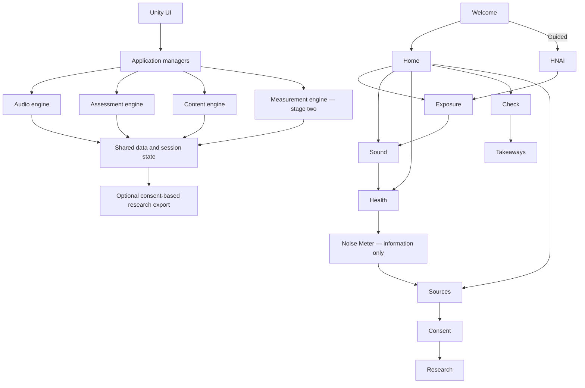

# Hearing Notion — Functional Prototype Architecture
Version 0.1 · World Hearing Forum · Unity/C#

Explore sound. Understand exposure. Protect your hearing.

## Product and scope
Build a functional, offline, desktop-first demonstration for Windows, with macOS as a subsequent build target, in English and Spanish. Participants should be able to complete a guided experience in approximately 5–8 minutes or explore modules independently. Audience: young adults, students, educators, hearing-health professionals, and the public. Desktop-first and bilingual support follow the supplied preference; mobile remains a later adaptation. Forum context does not imply institutional endorsement.

Core: welcome/navigation, exposure explorer, auditory simulations, hearing-health education, and awareness assessment. Second stage: estimated sound-level meter. Future: music-perception laboratory. Do not delay the core experience for microphone calibration. No account or cloud backend is needed.

## Application structure
Use one app-owned scene, `Assets/_HearingNotion/Scenes/Main.unity`, with persistent managers and modular Canvas panel roots. Main.unity now contains a template-derived home grid and introductory destination panels. It is the clickable navigation prototype; module interactions remain pending. Keep managers outside all screen roots. Use TextMesh Pro, uGUI, CanvasScaler, keyboard focus, and pointer interactions. Begin at a 1920×1080 reference resolution with responsive anchors; verify smaller desktop windows and long Spanish text. Actual device and headphone output testing remains required.

The public path does not require research consent or a baseline research questionnaire. Sound demonstrations are optional and can be skipped. Research consent gates only research administration and research export. The current guided journey starts with the full Spanish HNAI, then Exposure Explorer, Sound Experience, Hearing Health recommendations, informational Noise Meter and Research & Resources. Brief Spanish introduction modals appear once per stage per run. Completing HNAI enables guided continuation. Full HNAI may extend the original 5–8-minute target; duration must be measured rather than assumed. See GuidedExperience.md.

## Screen by screen design
| Screen | Content and interaction | Navigation and Unity components |
| --- | --- | --- |
| Welcome | Purpose, EN/ES selection, listening instructions, Start guided, Explore freely. Record acknowledgement only before audio playback. | AppManager, NavigationManager, SessionManager; TMP labels, language buttons, safety panel. |
| Home | Five core module cards, Research & Sources, session reset. Noise Meter marked stage two; Music Lab marked future, neither launches an unfinished feature. | Menu template cards; persistent Home/Back/Settings controls. |
| Exposure Explorer | Environmental/recreational/occupational category filters; selectable activity cards; detail panel with description, research prevalence and study context, linked audio, sourced acoustic ranges where available, prevention. | ExposureManager; ScrollRect, GridLayoutGroup, card prefab, detail panel. Guided Next works with no selections. |
| Sound Experience | Tabs for protection, hearing loss and tinnitus; approved example selection, original/processed A/B where applicable, play/pause, stop, repeat, explanation, captions, comfortable-volume prompt, optional skip. | AudioSimulationManager and AudioSafetyManager; persistent AudioSources, audio player prefab, Slider, Buttons. Leaving screen, reset, loss of focus, or pause stops playback. |
| Hearing Health | Five topic cards: auditory damage, tinnitus, concentration/listening effort, sleep/stress/cardiovascular health, protection/safer listening. Each uses What happens / Why it matters / What can I do. | ContentManager; article panel, ScrollRect, read-more and Sources links, accessible text. |
| Awareness Check | Short app-authored educational questions, answer controls, immediate explanations, review and finish. Clearly label as learning feedback, separate from research scales. | AssessmentManager in public mode; Quiz layout adapted without competitive scoring; progress label, optional skip. |
| Personalized Takeaways | Selected activities, topics visited, knowledge feedback, relevant protective habits, choose a habit, optional retry. No diagnostic risk category or invented participant outcomes. | SessionManager and content lookup; Result/Tracker layout, action buttons; Home, Reset, optional reassessment. |
| Research & Sources | Study citations, methods, aggregate figures labeled by instrument/sample, limitations, separate research-mode entry. | ContentManager; source cards and detail panels; no synthesized individual data from figures. |
| Research Consent | Study-specific information, version, voluntary participation and export choices; accept/decline/withdraw. Unconfigured study cannot administer or export. | SessionManager plus future protocol controller; dialog/scroll panel. Decline returns to Sources, preserving public access. |
| Research Assessment | Full approved HNAI or YANS selected separately; exact language/version/scale, phase, save response in session, completion/missing-answer rules; scoring only from approved protocol. | AssessmentManager; JSON definition loader, question panel, response controls. Separate baseline/follow-up attempts and instrument IDs. |
| Settings | Language, captions/text preferences, audio mute, restart, privacy explanation. Reset confirmation stops audio and clears all visitor state. | ContentManager, AudioSafetyManager, SessionManager; Settings template, Slider Toggle, DialogBoxYesNo. |
| Noise Meter — stage two | Microphone permission, device selection, start/stop, estimated level and calibration status. Never equate uncalibrated digital RMS/dBFS with dBA. | NoiseMeterManager with independent acquisition/analysis/calibration adapters; disabled core navigation. |
| Music Lab — future | Reserved for hearing-loss-aware music processing research. | Separate future DSP module; disabled core navigation. |

## Manager responsibilities and interfaces
| Component | Responsibility and contract | Status |
| --- | --- | --- |
| AppManager | Initialize managers and a fresh session; report missing bindings. | Foundation implemented |
| NavigationManager | Registered panels, Back/Home, free exploration, guided Next/Skip, research route guard; ScreenChanged event. | Foundation implemented |
| ContentManager | Versioned activity/topic/audio catalogs, localized strings, references and fallbacks. | Designed; content data assets defined |
| ExposureManager | Select/deselect activity IDs; recommend associated examples without estimating individual risk. | Designed |
| AudioSimulationManager | One playback owner; play/pause/stop/repeat, aligned A/B timeline; curated rendered assets first, optional runtime DSP later. | Designed |
| AudioSafetyManager | Reviewed gain ceiling, fades, limiter strategy, safe transitions and stop on navigation/focus/reset. Reject unreviewed clips. Device acoustic output cannot be guaranteed by software gain. | Designed |
| AssessmentManager | Separate public feedback from research administration; validate JSON IDs/scales, phase, completion, scoring and responses. | Definition validation implemented; controller pending |
| NoiseMeterManager | Microphone acquisition, RMS, weighting, calibration and display context. | Deferred |
| SessionManager | In-memory visitor state, fresh reset, versioned research consent and withdrawal. SessionReset event. | Foundation implemented |
| DataExportManager | Explicit consent-based, user-initiated export with schema/protocol/instrument versions; no automatic export. | Designed; no export implemented |

Events decouple views and playback from navigation and reset. SessionReset subscribers must stop audio, clear UI answers and selections, and discard pending export data. They must unsubscribe when destroyed. SessionManager itself clears session data; visual/audio subscriber wiring awaits scene construction. The current consent setter is infrastructure, not an approved study consent workflow.

## Shared data contracts
ActivityDefinition: stable ID, category, localized description, optional research prevalence with source/group/sample context, soundscape ID, optional reference levels with units/metric/duration/measurement context/source, and prevention text. Prevalence describes reported activities, not measured exposure.

AudioExampleDefinition: stable ID, simulation type, original and processed clips, localized explanation/transcript, source/license record, content review state, approved gain. Protection compares original versus illustrative attenuation. Hearing-loss examples disclose simplifications. Tinnitus permits tonal/narrowband/broadband examples without automatic playback. The pilot's filters, modeled threshold shifts and approximately 6 kHz examples are research provenance, not automatically approved public playback settings. Review original research audio and distribution rights before import; no files have been supplied or imported here.

EducationalTopicDefinition: stable ID, localized title, What happens / Why it matters / What can I do, linked references, version/review state. Do not publish unreviewed numeric exposure guidance.

Questionnaire JSON: schemaVersion, instrumentId, instrumentVersion, language, mode, protocolId, administrationPhase, instructions, ordered items with stable IDs and instrument-specific domain IDs, response choices, scoring specification, missing-response rules, approval state. Public questions may have correct answers and feedback; HNAI/YANS responses must not use correctness feedback. Distinct instrument identifiers prevent mixing scales. The current ScriptableObject definition validates IDs/choices as a foundation; the JSON loader and scoring engine are pending.

HNAI source: refined 22-item model, Perceived Knowledge 9, Perceived Exposure/Impact 5, Perceived Awareness 8. Preserve exact source wording. Response labels, reverse coding, timing and scoring require confirmation; preliminary validation and weaker Exposure/Impact reliability must remain visible in research context. The pilot's earlier 18-item instrument is a separate version. YANS has a separate four-factor structure; supplied figures do not contain its complete items or scoring protocol. Attitude changes do not establish changed protective behavior.

Session: language, journey mode, selected activity IDs, completed topics, public feedback/research response records, chosen habit, consent version and timestamp. No personally identifiable information or disk persistence by default. Research additions require a protocol-specific pseudonymous identifier, consent governance and retention/deletion rules. Anonymous usage metrics remain optional, local and disabled until defined; no analytics SDK is included.

Export: explicit destination/action; schema version, protocol ID, consent record, instrument version, phase and timestamped responses. Exclude identifiers and public visitor data unless explicitly covered. Revocation clears in-memory research responses. Files already exported would require a documented withdrawal process; export is not implemented yet.

## Project organization and template reuse
App code and future scene/assets live under `Assets/_HearingNotion`: Scenes, Scripts/Core, Navigation, Exposure, Audio, Assessment, NoiseMeter, Data, Content; Prefabs/UI, ActivityCards, AudioPlayers; ScriptableObjects/Activities, AudioExamples, EducationalTopics; Audio/Soundscapes, HearingProtection, HearingLoss, Tinnitus; UI/Sprites, Fonts, Icons.

Unity's player packaging requires StreamingAssets at `Assets/StreamingAssets`, so questionnaire/localization JSON belongs under `Assets/StreamingAssets/HearingNotion/Questionnaires` and `Localization`, rather than the nested StreamingAssets path in the proposed outline. A platform-aware loader is needed for later WebGL/Android builds. Language content must be keyed EN/ES, with explicit fallback, and switching must preserve responses by stable IDs.

Retain the vendor package as reference. Reuse only selected layouts: Menu for Home; Category/Item List for Exposure; Music Playlist/Mixer for Sound; Blog News/News for Health; Quiz for Awareness; Result/Tracker for Takeaways; Settings for Settings; DialogBoxYesNo, Slider, Slider Toggle as needed. Copy chosen layouts into app-owned prefabs when composing Main; vendor scenes stay out of Build Settings. No login/account screens are needed. Mobile portrait layouts need deliberate desktop adaptation, not a blanket scene import.

## Delivery roadmap and verification
1. UI/navigation: compose Main scene, bilingual module cards, guided/free flow, back/home/reset, keyboard and pointer controls. Deliver clickable application.
2. Audio: review licenses/levels, import clips, A/B alignment, normalization/limiting/fades, explicit play, captions/skip, stop on interruption. Deliver functional auditory experience.
3. Content/assessments: authored activities, five topics, public knowledge check, instrument loader, approved research protocol and consent/export. Deliver complete guided experience.
4. Meter: independent microphone/calibration milestone; estimated output labeled with measurement limitations.
5. Demonstration readiness: device/headphone tests, offline operation, both languages, full visitor reset and 5–8-minute usability check, then platform builds.

This revision delivers the architecture, screen specifications, folders, content asset definitions, session/navigation code foundation. Main scene and initial English UI panels are now delivered as the navigation prototype. Audio/DSP, microphone measurement, bilingual copy, questionnaire administration, export, and a packaged player build remain pending. Verify code compilation now; verify scene navigation and state isolation after UI composition. Do not call unused module placeholders implemented features.

## Research sources
The supplied HNAI_FINAL.docx supports the refined instrument structure and limitations. The supplied IN_2025_1074726.e11911e94ac54402be41.pdf supports the pilot auditory intervention and platform direction. Demographic exposure.png, Factor comp (Y1 Y2).png and Sum fact comp (Y1 Y2).png are aggregate research context, not raw response datasets. Document contents are evidence inputs; the user's current specification defines implementation scope.

## Annex catalog and authored local audio

Exposure Explorer now uses 21 active records: 18 annex soundscapes and three chart-only labels. Multi-category membership preserves the annex contexts; inferred mappings are labeled. Resources/ActivityCatalog.asset is authoritative, with scene fallback references kept aligned. Numeric sound levels and chart prevalence are not inferred.

LocalSoundSourceLibrary stores per-activity authored audio assignments under Application.persistentDataPath/SoundSources. This content configuration survives visitor reset and is separate from temporary questionnaire/selection state. Editor/Windows file selection and a local-path fallback accept WAV/OGG/MP3 up to 50 MB after basic header checks; imported files remain unreviewed and playback is not added. See SoundscapeCatalog.md for mappings, storage, limitations and checks.
