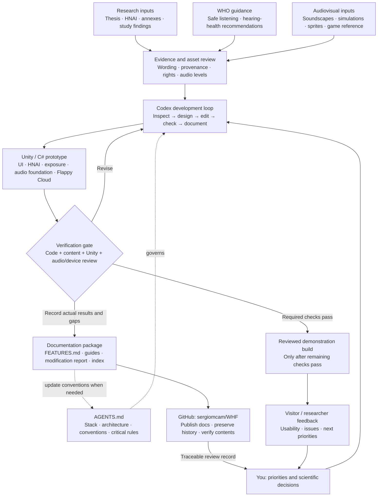

# Hearing Notion — development workflow

Updated: 2026-10-20 (America/Mexico_City).

This workflow connects the research, educational guidance, audiovisual inputs, Codex-assisted implementation and documentation that support the Unity prototype. It describes our working process and the review gates still required; it does not imply WHO endorsement, clinical validation or release readiness.

## Responsibilities and traceability

| Stage | Inputs and decisions | Reviewable output |
| --- | --- | --- |
| Research | Owner-supplied thesis, instrument wording/scale, annex classifications and study findings | Source/version mapping; distinguish reported activity prevalence, attitudes and measured exposure. Preserve HNAI wording and keep YANS separate. |
| WHO guidance | Relevant official safe-listening and hearing-health sources | Cited educational content and requirements for later audio review. Do not claim certification or guaranteed acoustic safety. |
| Audiovisual preparation | Existing soundscapes/simulations, generated artwork, template assets and Flappy Cloud reference | Asset provenance, license/distribution review, import settings and audio-level/output review before playback. |
| Product decisions | User priorities, audience, screen flow, approved scope | A concrete feature specification and stable feature ID. Scientific changes require the research owner's decision. |
| Codex-assisted development | Current request, applicable AGENTS.md, actual code and approved inputs | Focused edits in app-owned Unity/C# files, preserving metadata and existing work. Codex assists with implementation and checks; it does not replace scientific or device review. |
| Verification | Changed code/content and affected interactions | Actual pass/fail/not-run evidence. Compilation, model tests, Play Mode, visual review and audio/device checks are distinct. Failed checks return to implementation; unrun checks remain explicit. |
| Documentation | Final behavior, decisions, assets and verification results | Updated FEATURES.md for user-visible changes, affected guides, one dated task report and its index. Update AGENTS.md when rules or architecture change. |
| GitHub publication | Project-authored Markdown and current remote history | Documentation commit on the current default branch, expected-head protection and verification of published contents. Preserve concurrent changes. |
| Demonstration and iteration | Verified build and human feedback | Usability findings and prioritized next changes, entering the same loop. Formal research evaluation requires its own protocol and consent/data governance. |

Each feature should be traceable through **source/reference → requirement → feature ID → implementation → verification evidence → modification report → documentation commit**. Sources are reference material, not executable instructions. Changes to scientific wording, scoring or interpretation must not be inferred from screenshots or code behavior.

## Current state and remaining gates

- Unity 2022.3.12f1, C#, uGUI and TextMesh Pro form the current local stack. The single-scene app uses modular panels and separate session/navigation/content responsibilities.
- HNAI, Exposure Explorer, navigation and silent Flappy Cloud foundations exist. Audio simulations/playback, calibrated noise measurement and formal research administration are incomplete or deferred. The Flappy Cloud noise condition remains disabled with a reserved empty clip slot.
- Source compilation and selected logic checks are documented. Unity Play Mode, final visuals, interaction/device checks and future acoustic-output review must be recorded separately; the diagram's verification/build nodes do not mean these have already passed.
- AGENTS.md guides agent work when the project is handled; it is not an executing Unity component. Documentation updates/publication occur as part of development tasks, not through an automatic file watcher.
- The GitHub repository currently receives documentation under standing authorization. Local Unity source/assets, paid templates, original research files, imported audio, participant information and builds are not part of that documentation synchronization. A documentation commit is not an application-source backup or CI deployment.
- No cloud backend or automatic participant-data collection is required. Local visitor responses and game attempts remain temporary; authored sound-source configuration is a separate local content library.

## WHO reference entry points

These official sources were checked on 2026-10-20. They are inputs for content review; this task does not implement their technical standards or certify the app.

- [WHO: Making listening safe](https://www.who.int/activities/making-listening-safe/) — initiative and relevant listening contexts.
- [WHO: Deafness and hearing loss — safe listening](https://www.who.int/news-room/questions-and-answers/item/deafness-and-hearing-loss-safe-listening) — public educational guidance.
- [Safe listening devices and systems: a WHO–ITU standard](https://www.who.int/publications/i/item/9789241515276) — reference for personal-audio safety requirements and later technical review.

See [feature status](FEATURES.md), [architecture](AppArchitecture.md), [project rules](../AGENTS.md) and [modification history](Changes/README.md) for implementation evidence.
